# MCD / MLD — Plateforme S&E Ndao Hifanosika

> Document **généré** depuis `prisma/schema.prisma` par `scripts/gen-mcd.py` (53 entités, 14 énumérations). Ne pas éditer à la main : relancer le script.

## 1. Modèle conceptuel (relations)

Chaque trait relie une entité enfant (côté « plusieurs ») à son parent (côté « un »). Les attributs détaillés sont dans le dictionnaire (§3).

```mermaid
erDiagram
  Department ||--o{ User : "departmentId"
  Department ||--o{ Project : "departmentId"
  User ||--o{ Project : "createdById"
  Project ||--o{ Activity : "projectId"
  User ||--o{ Activity : "createdById"
  Project ||--o{ Milestone : "projectId"
  Project ||--o{ Beneficiary : "projectId"
  Zone ||--o{ Beneficiary : "zoneId"
  Project ||--o{ Evaluation : "projectId"
  User ||--o{ Evaluation : "createdById"
  Project ||--o{ Internship : "projectId"
  Department ||--o{ Internship : "departmentId"
  User ||--o{ Internship : "studentId"
  User ||--o{ Internship : "supervisorId"
  Internship ||--o{ InternshipProject : "internshipId"
  Project ||--o{ InternshipProject : "projectId"
  InternshipOffer ||--o{ InternshipApplication : "offerId"
  User ||--o{ InternshipApplication : "userId"
  InternshipApplication ||--o{ InternshipApplicationFile : "applicationId"
  User ||--o{ AuditLog : "userId"
  User ||--o{ PasswordResetToken : "userId"
  User ||--o{ Notification : "userId"
  User ||--o{ Notification : "senderId"
  Notification ||--o{ Notification : "replyToId"
  User ||--o{ NotificationAttachment : "uploaderId"
  User ||--o{ PushSubscription : "userId"
  Project ||--o{ Certificate : "projectId"
  Beneficiary ||--o{ Certificate : "beneficiaryId"
  Project ||--o{ ProjectPartner : "projectId"
  Partner ||--o{ ProjectPartner : "partnerId"
  Beneficiary ||--o{ BeneficiaryPartner : "beneficiaryId"
  Partner ||--o{ BeneficiaryPartner : "partnerId"
  Project ||--o{ ProjectObjective : "projectId"
  ProjectObjective ||--o{ ProjectResult : "objectiveId"
  ProjectResult ||--o{ ProjectIndicator : "resultId"
  User ||--o{ ProjectIndicator : "responsibleId"
  ProjectIndicator ||--o{ IndicatorMeasurement : "indicatorId"
  Project ||--o{ ProjectMonitoringSnapshot : "projectId"
  Internship ||--o{ InternshipTask : "internshipId"
  Internship ||--o{ InternshipEvaluation : "internshipId"
  User ||--o{ InternshipEvaluation : "evaluatorId"
  Certificate ||--o{ CertificatePartner : "certificateId"
  Partner ||--o{ CertificatePartner : "partnerId"
  User ||--o{ Mission : "agentId"
  Mission ||--o{ MissionPoint : "missionId"
  Beneficiary ||--o{ Survey : "beneficiaryId"
  User ||--o{ Survey : "agentId"
  Mission ||--o{ Survey : "missionId"
  User ||--o{ ScheduledMessage : "senderId"
  User ||--o{ UserPreference : "userId"
  User ||--o{ UserTwoFactor : "userId"
  Beneficiary ||--o{ PostProgramFollowUp : "beneficiaryId"
  Beneficiary ||--o{ BeneficiaryJourney : "beneficiaryId"
  Project ||--o{ ProjectCoordinator : "projectId"
  User ||--o{ ProjectCoordinator : "userId"
  Activity ||--o{ BeneficiaryAttendance : "activityId"
  Beneficiary ||--o{ BeneficiaryAttendance : "beneficiaryId"
  User ||--o{ MemberObjective : "userId"
  Internship ||--o{ InternshipDocument : "internshipId"
  Beneficiary ||--o{ BeneficiaryConsent : "beneficiaryId"
  RevokedRefreshToken
  AiModel
  EvaluationGrid
  EvaluationCampaign
  ActivityParticipation
  ActivityComment
  MeritSnapshot
  ReminderLog
  AnomalyAction
  ProjectFeedback
```

## 2. Énumérations

| Énumération | Valeurs |
|---|---|
| `UserStatus` | PENDING, ACTIVE, REJECTED, INACTIVE |
| `UserRole` | ADMIN, DIRECTION, DSI, DAF, RH, COMMUNICATION, COORDINATOR, TUTEUR_L3, TUTEUR_M2, STAGIAIRE_L3, STAGIAIRE_M2 |
| `ProjectStatus` | DRAFT, ACTIVE, SUSPENDED, COMPLETED, CANCELLED |
| `ActivityStatus` | PLANNED, IN_PROGRESS, COMPLETED, CANCELLED |
| `EvaluationStatus` | DRAFT, SUBMITTED, VALIDATED |
| `InternshipStatus` | PENDING, IN_PROGRESS, COMPLETED, CANCELLED |
| `NotificationType` | INFO, SUCCESS, WARNING, ERROR |
| `Gender` | MALE, FEMALE, OTHER |
| `ApplicationStatus` | PENDING, ACCEPTED, REJECTED |
| `PartnerType` | FUNDING_PARTNER, IMPLEMENTING_PARTNER, TECHNICAL_PARTNER, INSTITUTIONAL_PARTNER, OTHER |
| `InternshipTaskStatus` | TODO, IN_PROGRESS, COMPLETED, BLOCKED, CANCELLED |
| `FollowUpStatus` | PENDING, DONE, MISSED |
| `FollowUpOccupation` | EMPLOYED, SELF_EMPLOYED, IN_TRAINING, SEEKING, INACTIVE |
| `JourneyStatus` | ACTIVE, COMPLETED, DROPPED_OUT |

## 3. Modèle logique (dictionnaire des tables)

### User

| Colonne | Type | Null | Clé | Remarque |
|---|---|---|---|---|
| `id` | Int | non | PK |  |
| `firstName` | String | non |  |  |
| `lastName` | String | non |  |  |
| `email` | String | non | UNIQUE |  |
| `password` | String | non |  |  |
| `phone` | String | oui |  |  |
| `gender` | Gender | oui |  |  |
| `birthDate` | DateTime | oui |  |  |
| `birthPlace` | String | oui |  |  |
| `cinNumber` | String | oui |  |  |
| `cinIssuedAt` | DateTime | oui |  |  |
| `cinIssuedPlace` | String | oui |  |  |
| `cinDuplicata` | Boolean | non |  |  |
| `cinDuplicataAt` | DateTime | oui |  |  |
| `studentLevel` | String | oui |  | Niveau libre d'un stagiaire (option « Autre » du formulaire de stage) ; null pour L3 / M2 |
| `matricule` | String | oui | UNIQUE | Matricule du stagiaire (N° d'inscription, ex. NH-2026-STG-0001) : fixe, repris comme N° de ses certificats de stage |
| `tutorLevel` | String | oui |  | Niveau libre d'un tuteur ajouté avec « Autre » (ex. « Doctorat », « Expert ») |
| `role` | UserRole | non |  |  |
| `status` | UserStatus | non |  |  |
| `departmentId` | Int | oui | FK → Department |  |
| `createdAt` | DateTime | non |  |  |
| `updatedAt` | DateTime | non |  |  |
| `lastLoginAt` | DateTime | oui |  |  |
| `avatarUrl` | String | oui |  |  |
| `notifyEmail` | Boolean | non |  |  |
| `notifySms` | Boolean | non |  |  |
| `twoFactorEnabled` | Boolean | non |  |  |
| `twoFactorSecret` | String | oui |  |  |
| `twoFactorBackupCodes` | String[] | non |  |  |
| `settings` | Json | oui |  |  |
| `latitude` | Float | oui |  |  |
| `longitude` | Float | oui |  |  |
| `altitude` | Float | oui |  |  |
| `locationUpdatedAt` | DateTime | oui |  |  |
| `sharingLocation` | Boolean | non |  |  |

### Department

| Colonne | Type | Null | Clé | Remarque |
|---|---|---|---|---|
| `id` | Int | non | PK |  |
| `name` | String | non | UNIQUE |  |
| `description` | String | oui |  |  |
| `code` | String | oui | UNIQUE |  |
| `createdAt` | DateTime | non |  |  |
| `updatedAt` | DateTime | non |  |  |

### Project

| Colonne | Type | Null | Clé | Remarque |
|---|---|---|---|---|
| `id` | Int | non | PK |  |
| `name` | String | non |  |  |
| `code` | String | non | UNIQUE |  |
| `description` | String | oui |  |  |
| `objective` | String | oui |  |  |
| `slogan` | String | oui |  | Slogan du projet : imprimé sur les certificats des bénéficiaires |
| `startDate` | DateTime | oui |  |  |
| `endDate` | DateTime | oui |  |  |
| `status` | ProjectStatus | non |  |  |
| `budget` | Decimal | oui |  |  |
| `budgetSpent` | Decimal | oui |  |  |
| `beneficiaryTarget` | Int | oui |  |  |
| `departmentId` | Int | oui | FK → Department |  |
| `createdById` | Int | non | FK → User |  |
| `createdAt` | DateTime | non |  |  |
| `updatedAt` | DateTime | non |  |  |

### Activity

| Colonne | Type | Null | Clé | Remarque |
|---|---|---|---|---|
| `id` | Int | non | PK |  |
| `projectId` | Int | non | FK → Project |  |
| `title` | String | non |  |  |
| `description` | String | oui |  |  |
| `location` | String | oui |  |  |
| `startDate` | DateTime | oui |  |  |
| `endDate` | DateTime | oui |  |  |
| `status` | ActivityStatus | non |  |  |
| `budget` | Decimal | oui |  |  |
| `budgetSpent` | Decimal | oui |  |  |
| `progress` | Int | non |  | Avancement réel 0-100 (S&E) ; le statut en est déduit automatiquement |
| `actualStartDate` | DateTime | oui |  |  |
| `actualEndDate` | DateTime | oui |  |  |
| `createdById` | Int | non | FK → User |  |
| `createdAt` | DateTime | non |  |  |
| `updatedAt` | DateTime | non |  |  |

### Milestone

| Colonne | Type | Null | Clé | Remarque |
|---|---|---|---|---|
| `id` | Int | non | PK |  |
| `projectId` | Int | non | FK → Project |  |
| `title` | String | non |  |  |
| `description` | String | oui |  |  |
| `dueDate` | DateTime | oui |  |  |
| `completedAt` | DateTime | oui |  |  |
| `progress` | Int | non |  |  |
| `createdAt` | DateTime | non |  |  |
| `updatedAt` | DateTime | non |  |  |

### Beneficiary

| Colonne | Type | Null | Clé | Remarque |
|---|---|---|---|---|
| `id` | Int | non | PK |  |
| `projectId` | Int | non | FK → Project |  |
| `firstName` | String | non |  |  |
| `lastName` | String | non |  |  |
| `gender` | Gender | oui |  |  |
| `age` | Int | oui |  |  |
| `phone` | String | oui |  |  |
| `email` | String | oui |  |  |
| `vulnerable` | Boolean | non |  |  |
| `latitude` | Float | oui |  |  |
| `longitude` | Float | oui |  |  |
| `locationAccuracy` | Float | oui |  |  |
| `lastSeenAt` | DateTime | oui |  |  |
| `trackingToken` | String | oui | UNIQUE |  |
| `trackingEnabled` | Boolean | non |  |  |
| `consentAt` | DateTime | oui |  |  |
| `altitude` | Float | oui |  |  |
| `zoneId` | Int | oui | FK → Zone |  |
| `locality` | String | oui |  |  |
| `adminProvince` | String | oui |  |  |
| `adminRegion` | String | oui |  |  |
| `adminDistrict` | String | oui |  |  |
| `adminCommune` | String | oui |  |  |
| `adminFokontany` | String | oui |  |  |
| `addressDetail` | String | oui |  |  |
| `zoneUnits` | String | oui |  |  |
| `homeLatitude` | Float | oui |  |  |
| `homeLongitude` | Float | oui |  |  |
| `homeAltitude` | Float | oui |  |  |
| `householdSize` | Int | oui |  |  |
| `monthlyIncome` | Float | oui |  |  |
| `childrenUnder5` | Int | oui |  |  |
| `hasDisability` | Boolean | non |  |  |
| `disabilityTypes` | String | oui |  |  |
| `birthDate` | DateTime | oui |  |  |
| `birthPlace` | String | oui |  |  |
| `cinNumber` | String | oui |  |  |
| `cinIssuedAt` | DateTime | oui |  |  |
| `cinIssuedPlace` | String | oui |  |  |
| `cinDuplicata` | Boolean | non |  |  |
| `cinDuplicataAt` | DateTime | oui |  |  |
| `createdAt` | DateTime | non |  |  |
| `updatedAt` | DateTime | non |  |  |

### Evaluation

| Colonne | Type | Null | Clé | Remarque |
|---|---|---|---|---|
| `id` | Int | non | PK |  |
| `projectId` | Int | non | FK → Project |  |
| `title` | String | non |  |  |
| `description` | String | oui |  |  |
| `score` | Float | oui |  |  |
| `status` | EvaluationStatus | non |  |  |
| `evaluatedAt` | DateTime | oui |  |  |
| `createdById` | Int | non | FK → User |  |
| `createdAt` | DateTime | non |  |  |
| `updatedAt` | DateTime | non |  |  |
| `altitude` | Float | oui |  |  |

### Internship

| Colonne | Type | Null | Clé | Remarque |
|---|---|---|---|---|
| `id` | Int | non | PK |  |
| `projectId` | Int | oui | FK → Project |  |
| `studentId` | Int | non | FK → User |  |
| `supervisorId` | Int | oui | FK → User |  |
| `supervisorName` | String | oui |  | Tuteur saisi librement (option « Autre » du formulaire) quand il n'a pas de compte ; null si supervisorId est renseigné |
| `title` | String | non |  |  |
| `institution` | String | oui |  |  |
| `startDate` | DateTime | non |  |  |
| `endDate` | DateTime | oui |  |  |
| `status` | InternshipStatus | non |  |  |
| `description` | String | oui |  |  |
| `theme` | String | oui |  | Thème du stage (sujet du stagiaire) : imprimé sur le certificat et suivi par le S&E |
| `departmentId` | Int | oui | FK → Department | Département d'affectation du stagiaire (ex. « Suivi et Évaluation ») |
| `durationMonths` | Int | oui |  | Durée prévue (mois) pour le calcul de la présence : L3 = 2, M2 = 6, autre = saisie libre. NULL = ancien calcul. |
| `createdAt` | DateTime | non |  |  |
| `updatedAt` | DateTime | non |  |  |

### InternshipProject

| Colonne | Type | Null | Clé | Remarque |
|---|---|---|---|---|
| `internshipId` | Int | non | FK → Internship |  |
| `projectId` | Int | non | FK → Project |  |
| `createdAt` | DateTime | non |  |  |

### InternshipOffer

| Colonne | Type | Null | Clé | Remarque |
|---|---|---|---|---|
| `id` | Int | non | PK |  |
| `title` | String | non |  |  |
| `domain` | String | oui |  |  |
| `location` | String | oui |  |  |
| `duration` | String | oui |  |  |
| `deadline` | DateTime | oui |  |  |
| `places` | Int | oui |  |  |
| `description` | String | non |  |  |
| `isActive` | Boolean | non |  |  |
| `createdById` | Int | oui |  |  |
| `createdAt` | DateTime | non |  |  |
| `updatedAt` | DateTime | non |  |  |

### InternshipApplication

| Colonne | Type | Null | Clé | Remarque |
|---|---|---|---|---|
| `id` | Int | non | PK |  |
| `offerId` | Int | non | FK → InternshipOffer |  |
| `userId` | Int | oui | FK → User |  |
| `applicantName` | String | oui |  |  |
| `applicantEmail` | String | oui |  |  |
| `phone` | String | oui |  |  |
| `school` | String | oui |  |  |
| `level` | String | oui |  |  |
| `motivation` | String | non |  |  |
| `status` | ApplicationStatus | non |  |  |
| `createdAt` | DateTime | non |  |  |
| `dossierNumber` | String | oui | UNIQUE |  |
| `fileName` | String | oui |  |  |
| `fileMime` | String | oui |  |  |
| `fileSize` | Int | oui |  |  |
| `fileData` | Bytes | oui |  |  |

### InternshipApplicationFile

| Colonne | Type | Null | Clé | Remarque |
|---|---|---|---|---|
| `id` | Int | non | PK |  |
| `applicationId` | Int | non | FK → InternshipApplication |  |
| `fileName` | String | non |  |  |
| `fileMime` | String | non |  |  |
| `fileSize` | Int | non |  |  |
| `fileData` | Bytes | non |  |  |
| `createdAt` | DateTime | non |  |  |

### AuditLog

| Colonne | Type | Null | Clé | Remarque |
|---|---|---|---|---|
| `id` | Int | non | PK |  |
| `userId` | Int | oui | FK → User |  |
| `action` | String | non |  |  |
| `entity` | String | oui |  |  |
| `entityId` | Int | oui |  |  |
| `details` | Json | oui |  |  |
| `ipAddress` | String | oui |  |  |
| `userAgent` | String | oui |  |  |
| `createdAt` | DateTime | non |  |  |

### PasswordResetToken

| Colonne | Type | Null | Clé | Remarque |
|---|---|---|---|---|
| `id` | String | non | PK |  |
| `userId` | Int | non | FK → User |  |
| `tokenHash` | String | non | UNIQUE |  |
| `expiresAt` | DateTime | non |  |  |
| `attempts` | Int | non |  |  |
| `usedAt` | DateTime | oui |  |  |
| `createdAt` | DateTime | non |  |  |

### RevokedRefreshToken

| Colonne | Type | Null | Clé | Remarque |
|---|---|---|---|---|
| `id` | String | non | PK |  |
| `tokenHash` | String | non | UNIQUE |  |
| `expiresAt` | DateTime | non |  |  |
| `createdAt` | DateTime | non |  |  |

### Notification

| Colonne | Type | Null | Clé | Remarque |
|---|---|---|---|---|
| `id` | Int | non | PK |  |
| `userId` | Int | non | FK → User |  |
| `senderId` | Int | oui | FK → User |  |
| `replyToId` | Int | oui | FK → Notification |  |
| `title` | String | non |  |  |
| `message` | String | non |  |  |
| `type` | NotificationType | non |  |  |
| `read` | Boolean | non |  |  |
| `archived` | Boolean | non |  |  |
| `batchId` | String | oui |  |  |
| `groupSize` | Int | oui |  |  |
| `receivedAt` | DateTime | oui |  |  |
| `latitude` | Float | oui |  |  |
| `longitude` | Float | oui |  |  |
| `accuracy` | Float | oui |  |  |
| `createdAt` | DateTime | non |  |  |

### NotificationAttachment

| Colonne | Type | Null | Clé | Remarque |
|---|---|---|---|---|
| `id` | Int | non | PK |  |
| `uploaderId` | Int | non | FK → User |  |
| `name` | String | non |  |  |
| `mime` | String | non |  |  |
| `kind` | String | non |  |  |
| `size` | Int | non |  |  |
| `data` | Bytes | non |  |  |
| `createdAt` | DateTime | non |  |  |

### PushSubscription

| Colonne | Type | Null | Clé | Remarque |
|---|---|---|---|---|
| `id` | Int | non | PK |  |
| `userId` | Int | non | FK → User |  |
| `endpoint` | String | non | UNIQUE |  |
| `p256dh` | String | non |  |  |
| `auth` | String | non |  |  |
| `userAgent` | String | oui |  |  |
| `createdAt` | DateTime | non |  |  |

### Zone

| Colonne | Type | Null | Clé | Remarque |
|---|---|---|---|---|
| `id` | Int | non | PK |  |
| `name` | String | non | UNIQUE |  |
| `region` | String | oui |  |  |
| `latitude` | Float | non |  |  |
| `longitude` | Float | non |  |  |
| `radiusKm` | Float | oui |  |  |
| `address` | String | oui |  |  |
| `level` | String | oui |  |  |
| `boundary` | String | oui |  |  |
| `phone` | String | oui |  |  |
| `email` | String | oui |  |  |
| `isHeadquarters` | Boolean | non |  |  |
| `isActive` | Boolean | non |  |  |
| `createdAt` | DateTime | non |  |  |
| `updatedAt` | DateTime | non |  |  |

### Certificate

| Colonne | Type | Null | Clé | Remarque |
|---|---|---|---|---|
| `id` | Int | non | PK |  |
| `code` | String | non | UNIQUE |  |
| `type` | String | non |  |  |
| `holderName` | String | non |  |  |
| `holderEmail` | String | oui |  |  |
| `title` | String | non |  |  |
| `description` | String | oui |  |  |
| `startDate` | DateTime | oui |  |  |
| `endDate` | DateTime | oui |  |  |
| `holderBirthDate` | DateTime | oui |  |  |
| `holderBirthPlace` | String | oui |  |  |
| `missionLocation` | String | oui |  |  |
| `mention` | String | oui |  | Mention de fin de stage et note finale /20 (calculée par le suivi & évaluation) |
| `finalScore` | Float | oui |  |  |
| `theme` | String | oui |  | (« a effectué avec sérieux son stage dans le département : X intitulé « thème » ») |
| `departmentName` | String | oui |  |  |
| `holderPhone` | String | oui |  |  |
| `holderCin` | String | oui |  |  |
| `holderCinIssuedAt` | DateTime | oui |  |  |
| `holderCinIssuedPlace` | String | oui |  |  |
| `holderCinDuplicata` | Boolean | non |  |  |
| `holderCinDuplicataAt` | DateTime | oui |  |  |
| `specialCase` | Boolean | non |  |  |
| `specialCaseNote` | String | oui |  |  |
| `slogan` | String | oui |  | Slogan du projet figé à la délivrance (reste identique même si le projet change) |
| `projectSlogans` | Json | oui |  | Slogan de chaque projet (nom + slogan), figé à la délivrance : affiché sous le nom du projet |
| `internshipId` | Int | oui |  |  |
| `projectId` | Int | oui | FK → Project |  |
| `beneficiaryId` | Int | oui | FK → Beneficiary |  |
| `userId` | Int | oui |  |  |
| `issuedById` | Int | oui |  |  |
| `revokedAt` | DateTime | oui |  |  |
| `expiresAt` | DateTime | oui |  |  |
| `createdAt` | DateTime | non |  |  |

### Partner

| Colonne | Type | Null | Clé | Remarque |
|---|---|---|---|---|
| `id` | Int | non | PK |  |
| `name` | String | non |  |  |
| `type` | PartnerType | non |  |  |
| `slogan` | String | oui |  |  |
| `logoUrl` | String | oui |  |  |
| `website` | String | oui |  |  |
| `description` | String | oui |  |  |
| `email` | String | oui |  |  |
| `phone` | String | oui |  |  |
| `address` | String | oui |  |  |
| `isActive` | Boolean | non |  |  |
| `createdAt` | DateTime | non |  |  |
| `updatedAt` | DateTime | non |  |  |

### ProjectPartner

| Colonne | Type | Null | Clé | Remarque |
|---|---|---|---|---|
| `id` | Int | non | PK |  |
| `projectId` | Int | non | FK → Project |  |
| `partnerId` | Int | non | FK → Partner |  |
| `role` | String | oui |  |  |
| `contribution` | String | oui |  |  |
| `startDate` | DateTime | oui |  |  |
| `endDate` | DateTime | oui |  |  |
| `createdAt` | DateTime | non |  |  |

### BeneficiaryPartner

| Colonne | Type | Null | Clé | Remarque |
|---|---|---|---|---|
| `id` | Int | non | PK |  |
| `beneficiaryId` | Int | non | FK → Beneficiary |  |
| `partnerId` | Int | non | FK → Partner |  |
| `role` | String | oui |  |  |
| `supportType` | String | oui |  |  |
| `startDate` | DateTime | oui |  |  |
| `endDate` | DateTime | oui |  |  |
| `notes` | String | oui |  |  |
| `createdAt` | DateTime | non |  |  |

### ProjectObjective

| Colonne | Type | Null | Clé | Remarque |
|---|---|---|---|---|
| `id` | Int | non | PK |  |
| `projectId` | Int | non | FK → Project |  |
| `title` | String | non |  |  |
| `description` | String | oui |  |  |
| `order` | Int | non |  |  |
| `createdAt` | DateTime | non |  |  |
| `updatedAt` | DateTime | non |  |  |

### ProjectResult

| Colonne | Type | Null | Clé | Remarque |
|---|---|---|---|---|
| `id` | Int | non | PK |  |
| `objectiveId` | Int | non | FK → ProjectObjective |  |
| `title` | String | non |  |  |
| `description` | String | oui |  |  |
| `progress` | Int | non |  |  |
| `order` | Int | non |  |  |
| `createdAt` | DateTime | non |  |  |
| `updatedAt` | DateTime | non |  |  |

### ProjectIndicator

| Colonne | Type | Null | Clé | Remarque |
|---|---|---|---|---|
| `id` | Int | non | PK |  |
| `resultId` | Int | non | FK → ProjectResult |  |
| `name` | String | non |  |  |
| `description` | String | oui |  |  |
| `unit` | String | oui |  |  |
| `baseline` | Float | oui |  |  |
| `target` | Float | oui |  |  |
| `currentValue` | Float | oui |  |  |
| `source` | String | oui |  |  |
| `frequency` | String | oui |  |  |
| `responsibleId` | Int | oui | FK → User |  |
| `lastCollectedAt` | DateTime | oui |  |  |
| `createdAt` | DateTime | non |  |  |
| `updatedAt` | DateTime | non |  |  |

### IndicatorMeasurement

| Colonne | Type | Null | Clé | Remarque |
|---|---|---|---|---|
| `id` | Int | non | PK |  |
| `indicatorId` | Int | non | FK → ProjectIndicator |  |
| `value` | Float | non |  |  |
| `collectedAt` | DateTime | non |  |  |
| `collectedById` | Int | oui |  |  |
| `note` | String | oui |  |  |
| `createdAt` | DateTime | non |  |  |

### ProjectMonitoringSnapshot

| Colonne | Type | Null | Clé | Remarque |
|---|---|---|---|---|
| `id` | Int | non | PK |  |
| `projectId` | Int | non | FK → Project |  |
| `plannedProgress` | Int | non |  |  |
| `actualProgress` | Int | non |  |  |
| `gap` | Int | non |  |  |
| `recordedAt` | DateTime | non |  |  |
| `note` | String | oui |  |  |

### InternshipTask

| Colonne | Type | Null | Clé | Remarque |
|---|---|---|---|---|
| `id` | Int | non | PK |  |
| `internshipId` | Int | non | FK → Internship |  |
| `title` | String | non |  |  |
| `description` | String | oui |  |  |
| `status` | InternshipTaskStatus | non |  |  |
| `progress` | Int | non |  |  |
| `dueDate` | DateTime | oui |  |  |
| `completedAt` | DateTime | oui |  |  |
| `report` | String | oui |  |  |
| `evidenceName` | String | oui |  |  |
| `evidenceMime` | String | oui |  |  |
| `evidenceSize` | Int | oui |  |  |
| `evidenceData` | Bytes | oui |  |  |
| `createdAt` | DateTime | non |  |  |
| `updatedAt` | DateTime | non |  |  |

### InternshipEvaluation

| Colonne | Type | Null | Clé | Remarque |
|---|---|---|---|---|
| `id` | Int | non | PK |  |
| `internshipId` | Int | non | FK → Internship |  |
| `evaluatorId` | Int | non | FK → User |  |
| `title` | String | non |  |  |
| `technicalScore` | Float | oui |  |  |
| `qualityScore` | Float | oui |  |  |
| `autonomyScore` | Float | oui |  |  |
| `punctualityScore` | Float | oui |  |  |
| `communicationScore` | Float | oui |  |  |
| `overallScore` | Float | oui |  |  |
| `comments` | String | oui |  |  |
| `evaluatedAt` | DateTime | oui |  |  |
| `createdAt` | DateTime | non |  |  |
| `updatedAt` | DateTime | non |  |  |

### CertificatePartner

| Colonne | Type | Null | Clé | Remarque |
|---|---|---|---|---|
| `id` | Int | non | PK |  |
| `certificateId` | Int | non | FK → Certificate |  |
| `partnerId` | Int | non | FK → Partner |  |
| `role` | String | oui |  |  |
| `displayOrder` | Int | non |  |  |
| `nameSnapshot` | String | non |  |  |
| `sloganSnapshot` | String | oui |  |  |
| `logoSnapshot` | String | oui |  |  |

### AiModel

| Colonne | Type | Null | Clé | Remarque |
|---|---|---|---|---|
| `id` | Int | non | PK |  |
| `name` | String | non |  |  |
| `kind` | String | non |  |  |
| `sampleSize` | Int | non |  |  |
| `metrics` | Json | non |  |  |
| `weights` | Json | non |  |  |
| `trainedAt` | DateTime | non |  |  |

### EvaluationGrid

| Colonne | Type | Null | Clé | Remarque |
|---|---|---|---|---|
| `id` | Int | non | PK |  |
| `name` | String | non |  |  |
| `description` | String | oui |  |  |
| `criteria` | Json | non |  |  |
| `createdById` | Int | oui |  |  |
| `createdAt` | DateTime | non |  |  |
| `updatedAt` | DateTime | non |  |  |

### EvaluationCampaign

| Colonne | Type | Null | Clé | Remarque |
|---|---|---|---|---|
| `id` | Int | non | PK |  |
| `name` | String | non |  |  |
| `description` | String | oui |  |  |
| `gridId` | Int | oui |  |  |
| `projectId` | Int | oui |  |  |
| `startDate` | DateTime | oui |  |  |
| `endDate` | DateTime | oui |  |  |
| `status` | String | non |  |  |
| `createdById` | Int | oui |  |  |
| `createdAt` | DateTime | non |  |  |
| `updatedAt` | DateTime | non |  |  |

### Mission

| Colonne | Type | Null | Clé | Remarque |
|---|---|---|---|---|
| `id` | Int | non | PK |  |
| `agentId` | Int | non | FK → User |  |
| `startedAt` | DateTime | non |  |  |
| `endedAt` | DateTime | oui |  |  |
| `distanceKm` | Float | non |  |  |
| `endReason` | String | oui |  |  |

### MissionPoint

| Colonne | Type | Null | Clé | Remarque |
|---|---|---|---|---|
| `id` | Int | non | PK |  |
| `missionId` | Int | non | FK → Mission |  |
| `latitude` | Float | non |  |  |
| `longitude` | Float | non |  |  |
| `altitude` | Float | oui |  |  |
| `accuracy` | Float | oui |  |  |
| `heading` | Float | oui |  |  |
| `createdAt` | DateTime | non |  |  |

### Survey

| Colonne | Type | Null | Clé | Remarque |
|---|---|---|---|---|
| `id` | Int | non | PK |  |
| `beneficiaryId` | Int | non | FK → Beneficiary |  |
| `agentId` | Int | non | FK → User |  |
| `missionId` | Int | oui | FK → Mission |  |
| `latitude` | Float | oui |  |  |
| `longitude` | Float | oui |  |  |
| `altitude` | Float | oui |  |  |
| `householdSize` | Int | oui |  |  |
| `monthlyIncome` | Float | oui |  |  |
| `childrenUnder5` | Int | oui |  |  |
| `outOfSchoolChildren` | Int | oui |  |  |
| `mealsPerDay` | Int | oui |  |  |
| `hasDisability` | Boolean | non |  |  |
| `healthIssues` | Boolean | oui |  |  |
| `waterAccess` | Boolean | oui |  |  |
| `electricityAccess` | Boolean | oui |  |  |
| `housingType` | String | oui |  |  |
| `vulnerable` | Boolean | non |  |  |
| `notes` | String | oui |  |  |
| `createdAt` | DateTime | non |  |  |

### ScheduledMessage

| Colonne | Type | Null | Clé | Remarque |
|---|---|---|---|---|
| `id` | Int | non | PK |  |
| `senderId` | Int | non | FK → User |  |
| `audience` | Json | non |  |  |
| `title` | String | non |  |  |
| `message` | String | non |  |  |
| `type` | String | non |  |  |
| `latitude` | Float | oui |  |  |
| `longitude` | Float | oui |  |  |
| `accuracy` | Float | oui |  |  |
| `scheduledAt` | DateTime | non |  |  |
| `status` | String | non |  | PENDING | SENDING | SENT | FAILED | CANCELLED |
| `error` | String | oui |  |  |
| `recipientCount` | Int | oui |  |  |
| `sentAt` | DateTime | oui |  |  |
| `createdAt` | DateTime | non |  |  |

### ActivityParticipation

| Colonne | Type | Null | Clé | Remarque |
|---|---|---|---|---|
| `id` | Int | non | PK |  |
| `activityId` | Int | non |  |  |
| `userId` | Int | non |  |  |
| `status` | String | non |  |  |
| `message` | String | oui |  |  |
| `decidedById` | Int | oui |  |  |
| `decidedAt` | DateTime | oui |  |  |
| `report` | String | oui |  |  |
| `reportAt` | DateTime | oui |  |  |
| `proofName` | String | oui |  |  |
| `proofMime` | String | oui |  |  |
| `proofSize` | Int | oui |  |  |
| `proofData` | Bytes | oui |  |  |
| `checkedInAt` | DateTime | oui |  |  |
| `checkInLatitude` | Float | oui |  |  |
| `checkInLongitude` | Float | oui |  |  |
| `rating` | Int | oui |  |  |
| `ratingComment` | String | oui |  |  |
| `ratedById` | Int | oui |  |  |
| `ratedAt` | DateTime | oui |  |  |
| `remindedStartAt` | DateTime | oui |  |  |
| `remindedReportAt` | DateTime | oui |  |  |
| `createdAt` | DateTime | non |  |  |
| `updatedAt` | DateTime | non |  |  |

### ActivityComment

| Colonne | Type | Null | Clé | Remarque |
|---|---|---|---|---|
| `id` | Int | non | PK |  |
| `activityId` | Int | non |  |  |
| `userId` | Int | non |  |  |
| `body` | String | non |  |  |
| `createdAt` | DateTime | non |  |  |

### MeritSnapshot

| Colonne | Type | Null | Clé | Remarque |
|---|---|---|---|---|
| `id` | Int | non | PK |  |
| `period` | String | non |  |  |
| `userId` | Int | non |  |  |
| `level` | String | non |  |  |
| `rank` | Int | non |  |  |
| `cohortSize` | Int | non |  |  |
| `score` | Float | non |  |  |
| `badge` | String | oui |  |  |
| `details` | Json | oui |  |  |
| `closedById` | Int | oui |  |  |
| `createdAt` | DateTime | non |  |  |

### UserPreference

| Colonne | Type | Null | Clé | Remarque |
|---|---|---|---|---|
| `userId` | Int | non | PK, FK → User |  |
| `emailNotifications` | Boolean | non |  |  |
| `pushNotifications` | Boolean | non |  |  |
| `evaluationReminders` | Boolean | non |  |  |
| `projectReminders` | Boolean | non |  |  |
| `reportReminders` | Boolean | non |  |  |
| `sessionTimeout` | Int | non |  |  |
| `theme` | String | non |  |  |
| `compactMode` | Boolean | non |  |  |
| `updatedAt` | DateTime | non |  |  |

### UserTwoFactor

| Colonne | Type | Null | Clé | Remarque |
|---|---|---|---|---|
| `userId` | Int | non | PK, FK → User |  |
| `secret` | String | non |  |  |
| `enabled` | Boolean | non |  |  |
| `enabledAt` | DateTime | oui |  |  |
| `backupCodes` | Json | non |  |  |
| `lastUsedStep` | Int | oui |  |  |
| `createdAt` | DateTime | non |  |  |
| `updatedAt` | DateTime | non |  |  |

### ReminderLog

| Colonne | Type | Null | Clé | Remarque |
|---|---|---|---|---|
| `id` | Int | non | PK |  |
| `key` | String | non | UNIQUE |  |
| `kind` | String | non |  |  |
| `sentAt` | DateTime | non |  |  |

### AnomalyAction

| Colonne | Type | Null | Clé | Remarque |
|---|---|---|---|---|
| `id` | Int | non | PK |  |
| `key` | String | non | UNIQUE |  |
| `type` | String | non |  |  |
| `title` | String | non |  |  |
| `status` | String | non |  |  |
| `note` | String | oui |  |  |
| `snoozedUntil` | DateTime | oui |  |  |
| `userId` | Int | oui |  |  |
| `userName` | String | oui |  |  |
| `createdAt` | DateTime | non |  |  |
| `updatedAt` | DateTime | non |  |  |

### ProjectFeedback

| Colonne | Type | Null | Clé | Remarque |
|---|---|---|---|---|
| `id` | Int | non | PK |  |
| `projectId` | Int | non |  |  |
| `kind` | String | non |  | PARTNER | BENEFICIARY |
| `partnerId` | Int | oui |  |  |
| `beneficiaryId` | Int | oui |  |  |
| `respondent` | String | oui |  | Nom de la personne interrogée (représentant du partenaire, bénéficiaire anonyme…) |
| `ratings` | Json | non |  |  |
| `score` | Float | non |  |  |
| `comment` | String | oui |  |  |
| `collectedById` | Int | oui |  |  |
| `collectedAt` | DateTime | non |  |  |
| `createdAt` | DateTime | non |  |  |

### PostProgramFollowUp

| Colonne | Type | Null | Clé | Remarque |
|---|---|---|---|---|
| `id` | Int | non | PK |  |
| `beneficiaryId` | Int | non | FK → Beneficiary |  |
| `horizonMonths` | Int | non |  | 3, 6 ou 12 (mois après la fin du programme) |
| `dueDate` | DateTime | non |  |  |
| `status` | FollowUpStatus | non |  |  |
| `completedAt` | DateTime | oui |  |  |
| `occupation` | FollowUpOccupation | oui |  |  |
| `activityCreated` | Boolean | oui |  |  |
| `monthlyIncome` | Float | oui |  |  |
| `satisfaction` | Int | oui |  | Satisfaction 1 à 5 |
| `notes` | String | oui |  |  |
| `completedById` | Int | oui |  |  |
| `createdAt` | DateTime | non |  |  |
| `updatedAt` | DateTime | non |  |  |

### BeneficiaryJourney

| Colonne | Type | Null | Clé | Remarque |
|---|---|---|---|---|
| `id` | Int | non | PK |  |
| `beneficiaryId` | Int | non | UNIQUE, FK → Beneficiary |  |
| `status` | JourneyStatus | non |  |  |
| `statusDate` | DateTime | oui |  |  |
| `dropoutReason` | String | oui |  |  |
| `recordedById` | Int | oui |  |  |
| `createdAt` | DateTime | non |  |  |
| `updatedAt` | DateTime | non |  |  |

### ProjectCoordinator

| Colonne | Type | Null | Clé | Remarque |
|---|---|---|---|---|
| `id` | Int | non | PK |  |
| `projectId` | Int | non | FK → Project |  |
| `userId` | Int | non | FK → User |  |
| `assignedById` | Int | oui |  |  |
| `createdAt` | DateTime | non |  |  |

### BeneficiaryAttendance

| Colonne | Type | Null | Clé | Remarque |
|---|---|---|---|---|
| `id` | Int | non | PK |  |
| `activityId` | Int | non | FK → Activity |  |
| `beneficiaryId` | Int | non | FK → Beneficiary |  |
| `present` | Boolean | non |  |  |
| `note` | String | oui |  |  |
| `recordedById` | Int | oui |  |  |
| `createdAt` | DateTime | non |  |  |
| `updatedAt` | DateTime | non |  |  |

### MemberObjective

| Colonne | Type | Null | Clé | Remarque |
|---|---|---|---|---|
| `id` | Int | non | PK |  |
| `userId` | Int | non | FK → User |  |
| `title` | String | non |  |  |
| `description` | String | oui |  |  |
| `kpi` | String | oui |  |  |
| `unit` | String | oui |  |  |
| `targetValue` | Float | oui |  |  |
| `currentValue` | Float | oui |  |  |
| `dueDate` | DateTime | oui |  |  |
| `status` | String | non |  |  |
| `projectId` | Int | oui |  |  |
| `createdById` | Int | oui |  |  |
| `createdAt` | DateTime | non |  |  |
| `updatedAt` | DateTime | non |  |  |

### InternshipDocument

| Colonne | Type | Null | Clé | Remarque |
|---|---|---|---|---|
| `id` | Int | non | PK |  |
| `internshipId` | Int | non | FK → Internship |  |
| `kind` | String | non |  |  |
| `name` | String | non |  |  |
| `mime` | String | non |  |  |
| `size` | Int | non |  |  |
| `data` | Bytes | non |  |  |
| `note` | String | oui |  |  |
| `uploadedById` | Int | oui |  |  |
| `createdAt` | DateTime | non |  |  |

### BeneficiaryConsent

| Colonne | Type | Null | Clé | Remarque |
|---|---|---|---|---|
| `id` | Int | non | PK |  |
| `beneficiaryId` | Int | non | UNIQUE, FK → Beneficiary |  |
| `guardianName` | String | non |  |  |
| `guardianRelation` | String | oui |  |  |
| `guardianContact` | String | oui |  |  |
| `scope` | String | oui |  |  |
| `consentAt` | DateTime | non |  |  |
| `revokedAt` | DateTime | oui |  |  |
| `recordedById` | Int | oui |  |  |
| `createdAt` | DateTime | non |  |  |
| `updatedAt` | DateTime | non |  |  |
